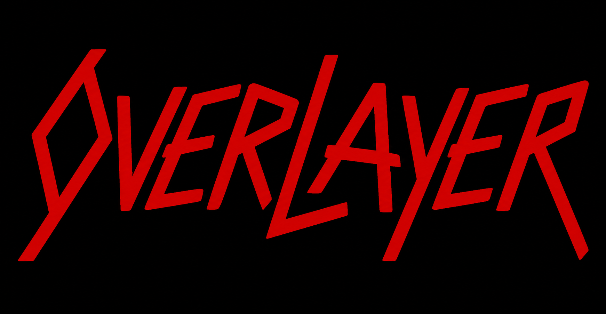

<p align="center">
  
</p>

# Overlayer

Lightweight **toasts** and **loading** indicator **overlays** for SwiftUI / UIKit apps that float above *any* screen (including modals and alerts) on their own `UIWindow`:

- **Toasts** sit on a *passthrough* window that never blocks the underlying interface; each toast still handles its own taps, buttons, and gestures.
- **Loading** sits on a *blocking* window that swallows every touch on the views beneath it (or passes them through, if you ask).

Highlights:

- iOS 16+, Swift 6 (tools 6.4) with strict concurrency, zero third-party dependencies, pure Swift.
- One service, two narrow protocols: inject `ToastPresenting`, `LoadingPresenting`, or the combined `OverlayService`.
- Setup (view registration + global config) lives on the `Overlayer` facade; runtime (`show` / `dismiss`) on the injected service.
- Toasts queue past a max visible count; per-toast `position` renders top / bottom / center in separate containers simultaneously.
- Pause a toast to read it — tap to toggle, or press-and-hold — then swipe toward the edge to dismiss (with a rubber-band pull).
- Loading blocks input by default, or passes touches through parametrically; indeterminate spinner and determinate progress out of the box.
- Built-in **close button** and bottom **progress bar** chrome, or render your own from the `ToastContext` (read `context.progress` inside a `TimelineView(.animation(paused: context.isPaused))` to animate it).
- Lifetimes run on a monotonic clock with one sleeping task per toast — nothing ticks, and a paused toast costs nothing.
- Register a model + view **independently** for any type — no enums, no switch — via one generic registry.
- Ready-made Success / Error / Info / Warning toasts and spinner / progress loaders live in the optional `OverlayerDefaults` product.

## Quick start

Register the view types you use once (e.g. in your `App` init). The ready-made views come from the optional `OverlayerDefaults` product; skip it if you register only your own. The overlay windows are created lazily on first use, so there is nothing else to wire up.

```swift
import Overlayer
import OverlayerDefaults

@main
struct DemoApp: App {
    init() {
        Overlayer.registerDefaultToasts()     // Success / Error / Info / Warning
        Overlayer.registerDefaultLoading()    // spinner + determinate progress
    }
    
    var body: some Scene {
        WindowGroup { 
            ContentView() 
        }
    }
}
```

### Toasts

Show a registered toast from anywhere via the service:

```swift
Overlayer.service.show(SuccessToastModel(message: "Saved"))

// per-call configuration; different positions show at the same time, in separate containers
Overlayer.service.show(ErrorToastModel(message: "Upload failed"), configuration: ToastConfiguration(position: .top, lifetime: .seconds(6)))
Overlayer.service.show(SuccessToastModel(message: "Draft saved"), configuration: ToastConfiguration(position: .bottom))
```

Toasts past the visible limit queue automatically. A toast can be paused to read it (a tap toggles pause, press-and-hold pauses while held), swiped toward its edge to dismiss, or closed via the built-in close button.

Register your own model + view — fully decoupled, no enums:

```swift
struct DownloadToastModel: ToastModel {
    let fileName: String
    let onOpen: () -> Void
}

struct DownloadToastView: View {
    let model: DownloadToastModel
    let context: ToastContext
    var body: some View {
        ToastCard(context: context, accent: .indigo) {     // bundled chrome: close button + progress bar
            VStack(alignment: .leading, spacing: 8) {
                Text("Downloaded \(model.fileName)").font(.subheadline.weight(.semibold))
                Button("Open") { model.onOpen(); context.dismiss() }
                    .buttonStyle(.borderedProminent)
            }
        }
    }
}

Overlayer.registerToast(DownloadToastModel.self) { model, context in
    DownloadToastView(model: model, context: context)
}
```

### Loading

A loading overlay blocks interaction until hidden; overlays stack, so nested loads are supported.

```swift
let id = Overlayer.service.showLoading(SpinnerLoadingModel(message: "Loading…"))
Overlayer.service.hideLoading(id)        // or hideAllLoading()
```

Determinate progress (file up/download) uses an observable you keep and update live:

```swift
let progress = LoadingProgress(message: "Uploading…")
let id = Overlayer.service.showLoading(ProgressLoadingModel(progress: progress))
progress.fraction = 0.4                    // updates the bar in place
progress.message = "Almost done…"
Overlayer.service.hideLoading(id)
```

Non-blocking (visual-only) — the spinner shows but the screen stays interactive:

```swift
Overlayer.service.showLoading(
    SpinnerLoadingModel(message: "Syncing…"),
    configuration: LoadingConfiguration(isBlocking: false, backgroundStyle: AnyShapeStyle(Color.clear))
)
```

Custom loading views register the same way via `Overlayer.registerLoading(_:content:)`; their `LoadingContext` can `dismiss()` (e.g. a Cancel button in blocking mode).

## Configuration

### Toasts

Stack-wide layout is set once on the facade; per-toast behaviour travels with each toast (or comes from a default).

```swift
Overlayer.toastContainerConfiguration = ToastContainerConfiguration(maxVisibleCount: 4, spacing: 8)
Overlayer.defaultToastConfiguration = ToastConfiguration(haptic: .notification(.success))
```

- **`ToastContainerConfiguration`** — the group, set via `Overlayer.toastContainerConfiguration`: `maxVisibleCount` (total across all positions), `spacing`, `edgeInsets`, `animation`. Toasts fill the available width minus `edgeInsets`.
- **`ToastConfiguration`** — one toast, passed to `show` (or `Overlayer.defaultToastConfiguration`): `position` (`.top` / `.bottom` / `.center`), `lifetime` (`.seconds(_)` / `.sticky`), `haptic`, `isSwipeToDismissEnabled`, `isTapToPauseEnabled`, `isHoldToPauseEnabled`, `showsCloseButton`, `showsProgressBar`.

### Loading

```swift
Overlayer.loadingConfiguration = LoadingConfiguration(backgroundStyle: AnyShapeStyle(.ultraThinMaterial))
```

- **`LoadingConfiguration`** — passed to `showLoading` (or `Overlayer.loadingConfiguration`): `isBlocking` (default `true`; `false` lets touches pass straight through), `backgroundStyle`, `ignoresSafeArea`, `animation`.

## Accessibility

- **VoiceOver announcements.** A toast is announced when it becomes visible, using its model's `accessibilityAnnouncement` (default `nil`; the bundled models announce their title and message):

```swift
struct DownloadToastModel: ToastModel {
    let fileName: String
    var accessibilityAnnouncement: String? { "Downloaded \(fileName)" }
}
```

- **Gestures as actions.** Swipe, tap and hold are not reachable with VoiceOver, so every toast offers *Dismiss* and *Pause* / *Resume* actions; the escape gesture (two-finger scrub) dismisses it.
- **Blocking loader is modal.** While a blocking loader is up, VoiceOver cannot reach the screen beneath, and focus moves to the loader and back when it hides. A non-blocking loader is announced via `LoadingModel.accessibilityAnnouncement` instead.
- **Reduce Motion.** Toasts fade instead of sliding or scaling.
- **Localization.** Built-in strings ship in English and Russian; they follow your app's localizations, so add Russian to the app to get them.

## Installation

Swift Package Manager — add the dependency in `Package.swift`:

```swift
dependencies: [
    .package(url: "https://github.com/thedemonswithin/overlayer.git", from: "2.0.0")
]
```

…and list `Overlayer` (plus `OverlayerDefaults` if you want the ready-made views) among your target's dependencies. Building the package requires Xcode with Swift 6.4; apps may target iOS 16+. Upgrading from 1.x: see [CHANGELOG.md](CHANGELOG.md). In Xcode: **File ▸ Add Package Dependencies…** and paste `https://github.com/thedemonswithin/overlayer.git`. 

## Notes

- Services, views and contexts are `@MainActor`; call them from the main actor (UI code already is). Configuration values and ids (`ToastConfiguration`, `ToastContainerConfiguration`, `LoadingConfiguration`, `ToastID`, `LoadingID`, …) are `nonisolated` and `Sendable`, so they can be built anywhere.
- Window levels: loading sits just above the app and its sheets (below system alerts and the keyboard); toasts sit above everything, so a toast can appear over a loading overlay.
- A non-blocking loading overlay passes every touch through (visual-only) — keep interactive controls (e.g. a Cancel button) for the default blocking mode.
- A blocking loading overlay ends text editing when it appears, since the keyboard sits above it.
- Overlay windows are shown only while they have content and are hidden once the last toast or loader has animated away.
- Status bar style and visibility, home indicator, and supported orientations follow your app's visible screen even while an overlay is up.
- On multi-window / iPad setups the overlays attach to the foreground-active `UIWindowScene` and move to another one if their scene is disconnected or goes to the background.
- **DI-friendly (e.g. DITranquility).** `OverlayServiceImpl.shared` conforms to `OverlayService` (and the narrower `ToastPresenting` / `LoadingPresenting`). Register the shared instance once and inject whichever protocol a screen needs:

```swift
container.register { OverlayServiceImpl.shared as OverlayService }.lifetime(.perContainer)
```
